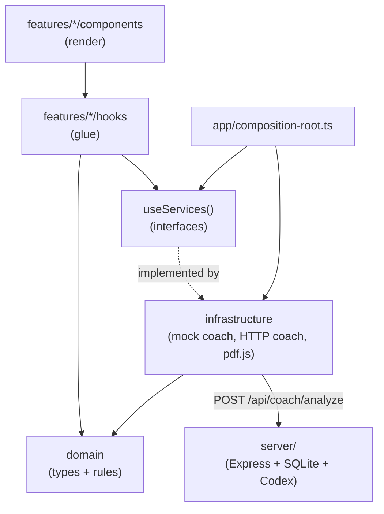
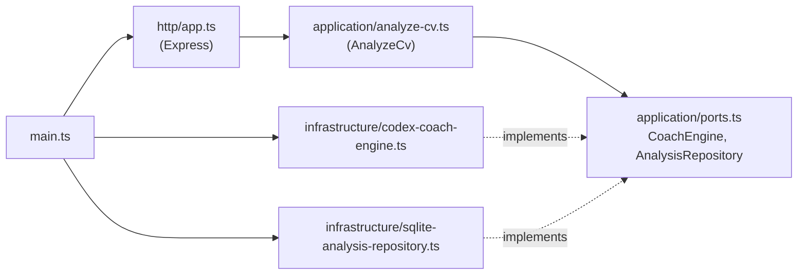

# Architecture

The code is split into **layers** with one-way dependencies. When you know which layer a piece
of code belongs to, you know where to put it, what it may import and how to test it.

## The folders

```text
src/
  domain/            Pure TypeScript: types, the CoachService interface, business rules
  infrastructure/    Code that talks to the outside world (fake coach, HTTP, pdf.js)
  app/               Composition root, providers, router, layout
  features/
    upload/          One folder per feature...
    profile/
    gaps/
    learning-path/
    dashboard/
    docs/
    coach-report/    ...plus the shared "current report" query used by all of them
  components/ui/     shadcn/ui primitives (generated, not edited)
  test/              Test helpers, MSW server, fixtures
server/src/
  application/       Use case and ports (interfaces), no Express/SQLite/Codex
  infrastructure/    SQLite repository, Codex engine
  http/              Express routes
  main.ts            Server composition root
docs/
  guide/             These pages
  specs/             Acceptance criteria per feature
  api-contract.md    The HTTP contract
```

Inside a feature the subfolders are always the same, and a feature only creates the ones it needs:

| Subfolder | Holds | Example |
| --- | --- | --- |
| `components/` | React components that render and delegate | `learning-step-card.tsx` |
| `hooks/` | Glue between components and TanStack Query, Zustand or domain functions | `use-learning-path.ts` |
| `model/` | Feature-local types and Zustand stores | `learning-progress-store.ts` |
| `api/` | Query keys and data loading | `coach-report-query.ts` |

## How the layers depend on each other



Arrows point from the code that imports to the code it imports. Three rules follow from the picture:

1. **`domain` imports nothing** from the other layers. It is plain TypeScript: no React, no
   `fetch`, no `localStorage`. That makes it easy to read and trivial to test.
2. **Features never import `infrastructure`.** They ask for services through `useServices()`,
   which only knows the interfaces. Only the composition root (`src/app/composition-root.ts`)
   decides whether the coach is the mock or the HTTP one.
3. **Components render and delegate.** A decision such as "which level is 45 points?" or "which
   step comes next?" is a domain function, called from a hook. The JSX only shows the answer.

## Why these rules?

- **Business rules are tested once, cheaply.** `levelForScore`, `detectGaps` and
  `orderLearningPath` are plain functions, so their tests need no browser, no React and no mocks.
  `src/domain` is kept at 100% test coverage.
- **The AI is replaceable.** The real coach is Codex today. Because the UI depends on the
  `CoachService` interface, a Java backend or another AI can be swapped in by changing one file.
- **Components stay small and boring**, which is exactly what you want from UI code.

## The rules are enforced, not just written down

ESLint fails the build when domain code imports something it should not:

```js
// eslint.config.js
  // Layer rule: src/domain is pure TypeScript. No React, no I/O, no other layers.
  // Tests may import shared fixtures from src/test.
  {
    files: ['src/domain/**/*.ts'],
    ignores: ['src/domain/**/*.test.ts'],
    rules: {
      'no-restricted-imports': [
        'error',
        {
          patterns: [
            {
              group: ['react', 'react-*', 'react/*'],
              message: 'Domain code must not depend on React.',
            },
            { group: ['@/*', '../*'], message: 'Domain code must not import from other layers.' },
```

Try it: add `import { useState } from 'react';` to `src/domain/gaps.ts` and run `pnpm lint`.

## The domain vocabulary

Names come from the problem, and every layer uses the same ones:

| Name | Meaning | Defined in |
| --- | --- | --- |
| `SkillArea` | One of the nine areas, e.g. `'concurrency'` | `src/domain/types.ts` |
| `SkillLevel` | `none`, `beginner`, `intermediate`, `advanced`, `expert` | `src/domain/types.ts` |
| `CoachReport` | What the coach returns for one CV: summary, assessments, steps | `src/domain/types.ts` |
| `SkillRating` | An area with its score, derived level and evidence | `src/domain/types.ts`, built by `rateSkills` |
| `Gap` | A missing or weak area with a reason | `src/domain/types.ts`, built by `detectGaps` |
| `LearningStep` | One step of the path: goal, topics, exercise, effort, prerequisites | `src/domain/types.ts` |

The coach returns **raw material** (scores and evidence). Levels, gaps and the path order are
derived by domain functions, so every backend gets the same rules:

```ts
// src/domain/types.ts
export interface CoachReport {
  summary: string;
  assessments: AreaAssessment[];
  steps: LearningStep[];
}
```

## The server has the same shape

The Node server uses the same idea, sometimes called *ports and adapters*:



`AnalyzeCv` knows *what* to do (hash the CV, reuse a stored report or ask the engine, then
save). It does not know that the engine is Codex or that the store is SQLite:

```ts
// server/src/application/ports.ts
export interface CoachEngine {
  analyze(cvText: string): Promise<CoachReport>;
}
```

Only `server/src/main.ts` knows every concrete class, just like `src/app/composition-root.ts`
in the web app.
