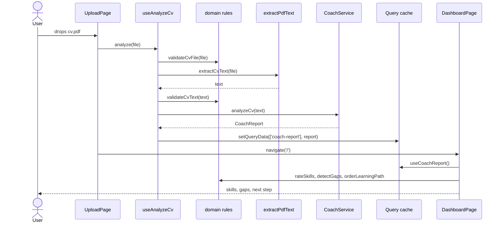

# Data flow

This page follows one CV from the moment you drop it on the upload page until its learning
path is on screen. Open the files as you read; every snippet below is copied from them (a test
checks that).

## The whole trip in one picture



## Step 1: the file arrives

`CvDropzone` is a plain component. It only hands the file to whoever is listening:

```tsx
// src/features/upload/components/cv-dropzone.tsx
  function handleDrop(event: DragEvent) {
    event.preventDefault();
    setIsDragging(false);
    const file = event.dataTransfer.files[0];
    if (file && !disabled) onFile(file);
  }
```

`UploadPage` connects it to the hook. Note that the page has no logic of its own: it reads
`status` and decides what to *show*, nothing else.

```tsx
// src/features/upload/components/upload-page.tsx
export function UploadPage() {
  const { analyze, status, errorMessage, reset } = useAnalyzeCv();
  const navigate = useNavigate();
  const isBusy = status === 'reading' || status === 'analyzing';
// ...
      <CvDropzone onFile={analyze} disabled={isBusy} />

      {isBusy && <UploadProgress status={status} />}
```

## Step 2: the pipeline in `useAnalyzeCv`

This hook is where the work happens. It is a TanStack Query **mutation**: a one-off async action
whose loading and error states TanStack tracks for us.

```ts
// src/features/upload/hooks/use-analyze-cv.ts
  const mutation = useMutation<CoachReport, UploadError, File>({
    mutationFn: async (file) => {
      const fileProblem = validateCvFile(file);
      if (fileProblem) throw new UploadError(fileProblem);

      setStage('reading');
      const text = await extractCvText(file).catch((cause: unknown) => {
        throw new UploadError('unreadable-pdf', cause);
      });
      const textProblem = validateCvText(text);
      if (textProblem) throw new UploadError(textProblem);

      setStage('analyzing');
      return coach.analyzeCv(text).catch((cause: unknown) => {
        throw new UploadError('coach-failed', cause);
      });
    },
    onSuccess: (report) => queryClient.setQueryData(coachReportQueryKey, report),
  });
```

Read it top to bottom:

1. **`validateCvFile`** (`src/domain/cv-file-rules.ts`) checks type and size. It is a pure
   function that returns a problem code such as `'too-large'`, or `null`.
2. **`extractCvText`** comes from `useServices()`. In the real app it is `extractPdfText`
   (`src/infrastructure/pdf/extract-pdf-text.ts`), which uses pdf.js to read the text **in the
   browser**. The PDF itself is never uploaded anywhere.
3. **`validateCvText`** rejects PDFs with (almost) no text, which usually means a scanned image.
4. **`coach.analyzeCv`** asks the coach. The hook does not know which coach it is.
5. **`onSuccess`** stores the report in the TanStack Query cache under `['coach-report']`.

Every failure becomes an `UploadError` whose message is written for people
(`src/features/upload/model/upload-error.ts`). The page simply shows `errorMessage`.

## Step 3: which coach?

`src/app/composition-root.ts` picks the implementation once, at start-up, from
`VITE_COACH_MODE`:

```ts
// src/app/composition-root.ts
  switch (mode) {
    case 'mock':
      return { coach: new MockCoachService(), extractCvText: extractPdfText };
    case 'http':
      return { coach: new HttpCoachService(), extractCvText: extractPdfText };
```

- **`MockCoachService`** scores each area from keywords in the CV text, waits 1.2 seconds to feel
  real, and returns a report. Same CV in, same report out.
- **`HttpCoachService`** sends the text to the server:

```ts
// src/infrastructure/coach/http-coach-service.ts
      response = await fetch(new URL(ANALYZE_PATH, this.baseUrl), {
        method: 'POST',
        headers: { 'Content-Type': 'application/json' },
        body: JSON.stringify({ cvText }),
      });
```

## Step 4 (http mode): the server asks Codex

The Express route validates the body and calls the use case:

```ts
// server/src/http/app.ts
  app.post('/api/coach/analyze', async (req, res) => {
    const parsed = analyzeRequestSchema.safeParse(req.body);
    if (!parsed.success) {
      sendError(res, 400, 'INVALID_REQUEST', 'cvText must be a string of 50 to 100000 characters.');
      return;
    }
    res.json(await analyzeCv.execute(parsed.data.cvText));
  });
```

`AnalyzeCv` first looks for the same CV in SQLite. Only if it is new does it ask the engine:

```ts
// server/src/application/analyze-cv.ts
  async execute(cvText: string): Promise<AnalyzeCvResult> {
    const text = cvText.trim();
    const cvHash = createHash('sha256').update(text).digest('hex');

    const stored = this.repository.findByCvHash(cvHash);
    if (stored) return { report: stored.report, cached: true };

    const report = await this.engine.analyze(text);
    this.repository.save({ cvHash, report, createdAt: this.now().toISOString() });
    return { report, cached: false };
  }
```

Only the hash is stored, never the CV text. The engine starts a Codex thread that is locked
down (read-only, no network, no approvals) and requires a JSON answer that matches the
`CoachReport` schema:

```ts
// server/src/infrastructure/codex-coach-engine.ts
    const thread = this.codex.startThread({
      model: this.model,
      sandboxMode: 'read-only',
      approvalPolicy: 'never',
      networkAccessEnabled: false,
      webSearchMode: 'disabled',
      workingDirectory: this.workingDirectory,
      skipGitRepoCheck: true,
    });
```

The answer is parsed and checked with zod (`coachReportSchema`), so the frontend never receives
something that is not a `CoachReport`. The exact request and response are documented in
`docs/api-contract.md`.

## Step 5: from cache to screen

After `onSuccess`, `UploadPage` sees `status === 'success'` and navigates to `/`. Every page
that needs the report reads it with one hook:

```ts
// src/features/coach-report/hooks/use-coach-report.ts
export function useCoachReport(): CoachReport | undefined {
  const { data } = useQuery<CoachReport>({ queryKey: coachReportQueryKey, queryFn: skipToken });
  return data;
}
```

`skipToken` tells TanStack Query "never fetch this yourself": the data only arrives through
`setQueryData` in step 2.

Feature hooks then turn the raw report into what their page needs, using domain functions:

```ts
// src/features/learning-path/hooks/use-learning-path.ts
  const orderedSteps = useMemo(
    () => (report ? orderLearningPath(report.steps, rateSkills(report)) : undefined),
    [report],
  );
```

- `rateSkills` (`src/domain/rate-skills.ts`) gives one `SkillRating` per area, using
  `levelForScore` (`src/domain/skill-level.ts`).
- `detectGaps` (`src/domain/gaps.ts`) keeps the `none` and `beginner` areas and writes a reason
  for each.
- `orderLearningPath` (`src/domain/learning-path.ts`) puts prerequisites first and the weakest
  areas next.

`DashboardPage` calls `useSkillRatings`, `useGaps` and `useLearningPath` and renders the result.

## Step 6: ticking a step

When you tick a step, `toggleStep` updates a small Zustand store, which saves itself in
localStorage. `useLearningPath` reads that store too, so the progress bar and "next step" update
immediately. See [State](/docs/state) for why that lives in Zustand and not in TanStack Query.
