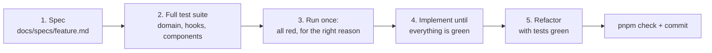

# Testing

Every feature in this repo was built **test-first, in batches**: write the spec, write the whole
test suite, watch it fail, then write the code. This page explains that workflow and shows one
real, annotated example of each kind of test.

## The workflow



1. **Spec.** `docs/specs/<feature>.md` lists numbered acceptance criteria (AC1, AC2, ...),
   written as what a user sees or what a function returns.
2. **Full test suite.** Every criterion gets at least one test, and the test name starts with
   its number, e.g. `it('AC16: rejects an invalid file without reading it', ...)`. You write
   all of them before any implementation.
3. **Confirm red.** Run the suite once. Each test must fail because the code does not exist yet
   ("Failed to resolve import './gaps'"), not because the test has a typo.
4. **Green.** Implement in layers: domain rules first, then hooks, then components.
5. **Refactor** names and structure while everything stays green.

Why batches and not one tiny test at a time? Writing the whole suite first forces you to think
through the feature (edge cases, errors, empty states) before the code nudges you toward
whatever is easiest to implement.

**Never weaken or delete a test to make it pass.** If a test is wrong, say so, fix the spec
first and then the test. The git history has examples: the gaps feature gained an edge case
("a beginner score without evidence") as a new criterion, a new failing test, then a fix.

## The kinds of tests

| Kind | Where | Tools | Checks |
| --- | --- | --- | --- |
| Domain unit | `src/domain/*.test.ts` | Vitest only | Business rules, every branch (100% coverage) |
| Hook | `src/features/*/hooks/*.test.tsx` | `renderHook`, `createWrapper` | How a hook combines services, cache and stores |
| Component | `src/features/*/components/*.test.tsx` | Testing Library, `userEvent` | What the user sees and can do |
| Infrastructure | `src/infrastructure/**/*.test.ts` | MSW, a real PDF | HTTP calls and PDF parsing |
| Server | `server/src/**/*.test.ts` | fakes, SQLite in memory, `supertest` | Use case, database, Codex engine, HTTP API |
| Docs | `src/features/docs/docs-snippets.test.ts` | Node `fs` | That code in these pages matches the source |

The shared helpers live in `src/test/`: `renderWithProviders` and `createWrapper` (every
provider the app uses, with fake services and an optional report), `deferred()` (a promise you
resolve by hand), fixtures such as `sampleReport`, and the MSW server.

## Example 1: a domain unit test

```ts
// src/domain/gaps.test.ts
function rating(overrides: Partial<SkillRating> & Pick<SkillRating, 'area'>): SkillRating {
  return { score: 50, level: 'intermediate', evidence: ['something'], ...overrides };
}

describe('detectGaps', () => {
  it('AC1: reports missing and weak areas, not intermediate or better', () => {
    const gaps = detectGaps([
      rating({ area: 'core-language', score: 70, level: 'advanced' }),
      rating({ area: 'oop', score: 45, level: 'intermediate' }),
      rating({ area: 'testing', score: 30, level: 'beginner', evidence: ['JUnit 5'] }),
      rating({ area: 'jvm', score: 0, level: 'none', evidence: [] }),
    ]);

    expect(gaps.map((g) => [g.area, g.severity])).toEqual([
      ['jvm', 'missing'],
      ['testing', 'weak'],
    ]);
  });
```

What to notice:

- **A small builder** (`rating(...)`) fills in boring defaults, so each test only spells out what
  matters for it.
- **No mocks at all.** Input in, output out. This is why business rules belong in `src/domain`.
- **The assertion states the rule**: only `none` and `beginner` areas are gaps, missing first.
- The `AC1:` prefix links the test to `docs/specs/gap-analysis.md`.

## Example 2: a hook test

```tsx
// src/features/upload/hooks/use-analyze-cv.test.tsx
  it('AC14/AC15: reads, analyses and stores the report, reporting each stage', async () => {
    const text = deferred<string>();
    const report = deferred<CoachReport>();
    const extractCvText = vi.fn(() => text.promise);
    const analyzeCv = vi.fn(() => report.promise);
    const { result } = renderUploadHook({ extractCvText, coach: { analyzeCv } });
    const file = makeFile();

    expect(result.current.upload.status).toBe('idle');
    act(() => result.current.upload.analyze(file));

    await waitFor(() => expect(result.current.upload.status).toBe('reading'));
    expect(extractCvText).toHaveBeenCalledWith(file);

    act(() => text.resolve(CV_TEXT));
    await waitFor(() => expect(result.current.upload.status).toBe('analyzing'));
    expect(analyzeCv).toHaveBeenCalledWith(CV_TEXT);

    act(() => report.resolve(sampleReport));
    await waitFor(() => expect(result.current.upload.status).toBe('success'));
    expect(result.current.report).toEqual(sampleReport);
  });
```

What to notice:

- **Fake services are injected**, not imported: `renderUploadHook` passes `extractCvText` and
  `coach` to `createWrapper`. This is dependency inversion paying off (see
  [SOLID](/docs/solid)).
- **`deferred()` freezes time.** The fake PDF reader does not answer until the test calls
  `text.resolve(...)`, so the test can check the `reading` stage before moving on.
- **The result is checked through another hook**, `useCoachReport`, rendered in the same
  wrapper. The test does not peek into the query cache; it checks what the rest of the app sees.

## Example 3: a component test

```tsx
// src/features/upload/components/upload-page.test.tsx
  it.each([
    [makeFile({ name: 'cv.docx', type: 'application/msword' }), 'Only PDF files are supported.'],
    [makeFile({ sizeBytes: 6 * 1024 * 1024 }), 'This file is larger than 5 MB.'],
    [makeFile({ sizeBytes: 0 }), 'This file is empty.'],
  ])('AC16: explains why %o is refused and does not read it', async (file, message) => {
    const extractCvText = vi.fn();
    const { pick } = renderPage({ extractCvText });

    await pick(file);

    expect(await screen.findByRole('alert')).toHaveTextContent(message);
    expect(extractCvText).not.toHaveBeenCalled();
  });
```

What to notice:

- **The test acts like a user**: `pick` uses `user.upload(screen.getByLabelText('Choose a PDF'), file)`,
  the same label a screen reader announces.
- **It queries by role** (`alert`), not by class name or test id, so restyling the page does
  not break it, and an inaccessible page would.
- **`it.each`** runs one test per row: three invalid files, one test body.
- It checks a **side effect that must not happen**: the PDF reader is never called.

Prefer `findBy...` (waits) for things that appear after async work, `getBy...` (fails at once)
for things that must already be there, and `queryBy...` (returns `null`) to assert absence.

## Example 4: an HTTP test with MSW

```ts
// src/infrastructure/coach/http-coach-service.test.ts
  it('AC9: posts the CV text and returns the report from the response', async () => {
    let receivedBody: unknown;
    server.use(
      http.post('*/api/coach/analyze', async ({ request }) => {
        receivedBody = await request.json();
        return HttpResponse.json({ report: sampleReport });
      }),
    );

    const report = await coach.analyzeCv('my cv text');

    expect(receivedBody).toEqual({ cvText: 'my cv text' });
    expect(report).toEqual(sampleReport);
  });
```

MSW intercepts the real `fetch` call, so `HttpCoachService` runs unchanged. The setup file starts
the MSW server with `onUnhandledRequest: 'error'`: any request a test did not expect fails the
test, so nothing can slip out to the real network.

## Example 5: a server API test

```ts
// server/src/http/app.test.ts
  it('AC19: reports a coach failure as 502 with the reason', async () => {
    const response = await request(
      appWith(() => Promise.reject(new CoachFailedError('Codex failed: Not logged in'))),
    )
      .post('/api/coach/analyze')
      .send({ cvText });

    expect(response.status).toBe(502);
    expect(response.body).toEqual({
      error: { code: 'COACH_FAILED', message: 'Codex failed: Not logged in' },
    });
  });
```

`createApp` builds the Express app without listening on a port, so `supertest` can call it
directly. The use case is a fake, so the test is about HTTP only: status codes and the error
shape from `docs/api-contract.md`. Codex is never called in any test.

## Example 6: a test for the docs

These pages quote real code. A test reads every guide, finds code blocks whose first line names
a file, and checks that the code still exists in that file:

```ts
// src/features/docs/docs-snippets.test.ts
  it.each(snippets.map((s) => [`${s.guide} -> ${s.file}`, s] as const))(
    'AC9: %s matches the source',
    (_name, snippet) => {
      const source = readFileSync(join(ROOT, snippet.file), 'utf8');
      for (const chunk of snippet.chunks) {
        expect(source, `chunk not found in ${snippet.file}:\n${chunk}`).toContain(chunk);
      }
    },
  );
```

If you rename a function and forget the docs, `pnpm test` tells you which page to fix.

## Coverage

`pnpm test:coverage` enforces 100% statements, branches, functions and lines for `src/domain`.
There is no coverage target for UI code: a number would push people to test implementation
details. Instead, every acceptance criterion must have a test.
